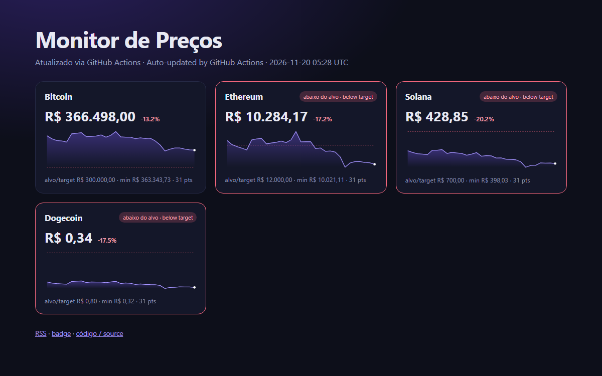
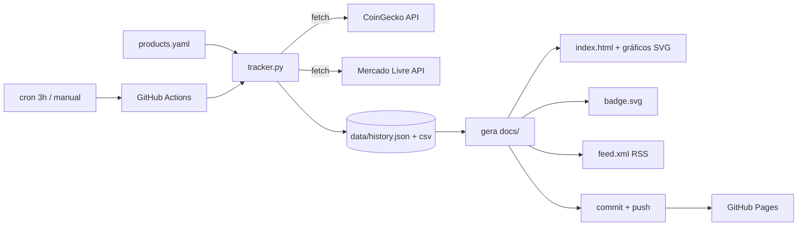

# Monitor de Preços · Price Monitor



**Demo:** https://alissonlittig.github.io/monitor-precos-actions/ · [RSS](https://alissonlittig.github.io/monitor-precos-actions/feed.xml)

## PT

Automação em Python que roda sozinha no GitHub Actions (cron a cada 3 h, grátis): consulta os preços de uma lista de produtos, guarda o histórico em JSON/CSV dentro do próprio repositório, gera uma página com gráficos (GitHub Pages), um badge e um feed RSS que registra quando um item cai abaixo do preço-alvo.

- Lista editável em `products.yaml` (id, nome, fonte, preço-alvo).
- Fontes plugáveis: `coingecko` (API pública, sem chave) e `mercadolivre` (API oficial; hoje exige token OAuth, defina o secret `ML_TOKEN`; sem ele a fonte é pulada).
- Se uma fonte falhar, as outras continuam.
- Os dados de exemplo usam criptomoedas porque a API é aberta e os preços se mexem o dia todo.

### Fluxo



### Como rodar

```bash
pip install pyyaml pytest
python seed.py      # opcional: 30 dias de histórico real
python tracker.py   # coleta e gera docs/
pytest -q tests
```
Para publicar: ative Pages em *Settings → Pages → Deploy from branch → main /docs*.

## EN

A Python automation that runs by itself on GitHub Actions (cron every 3 h, free): it fetches prices for a product list, stores history as JSON/CSV in the repo, builds a charts page (GitHub Pages), a badge and an RSS feed that logs when an item drops below its target price.

- Watchlist in `products.yaml`; pluggable sources: `coingecko` (public, keyless) and `mercadolivre` (official API, now requires an OAuth token: set the `ML_TOKEN` secret, otherwise skipped).
- A failing source never stops the others.
- Sample data uses crypto prices since the API is open and moves all day.

Run: see the commands above.

**Stack:** Python 3 · PyYAML · GitHub Actions · GitHub Pages · SVG · RSS · pytest
